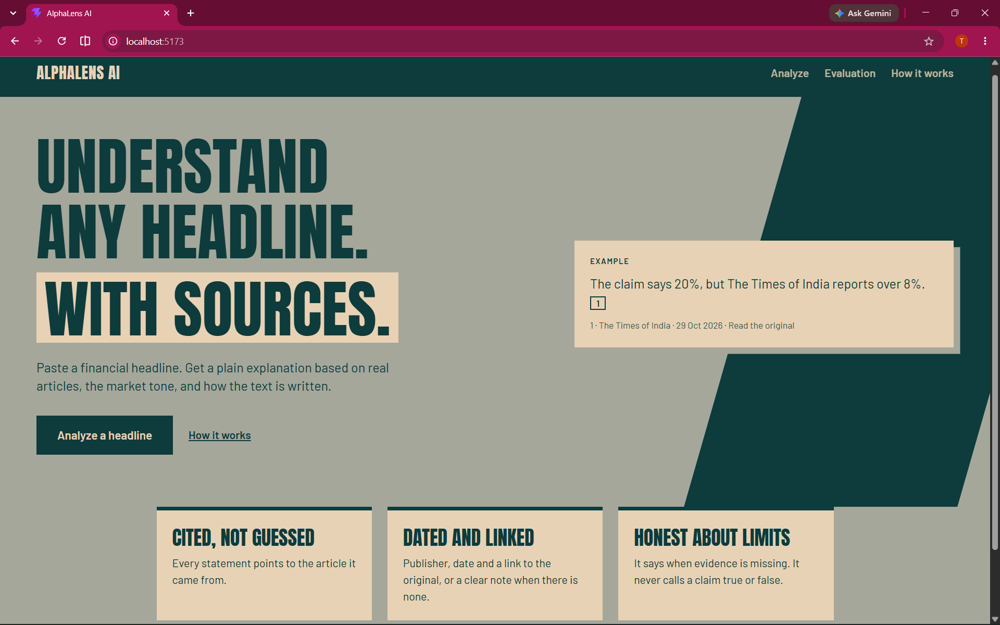
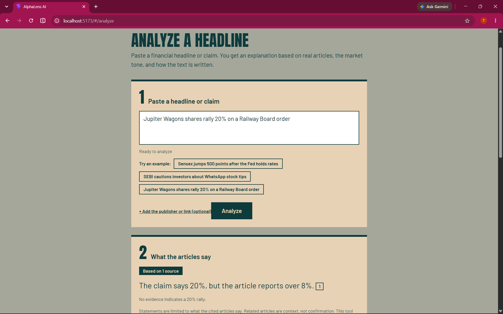
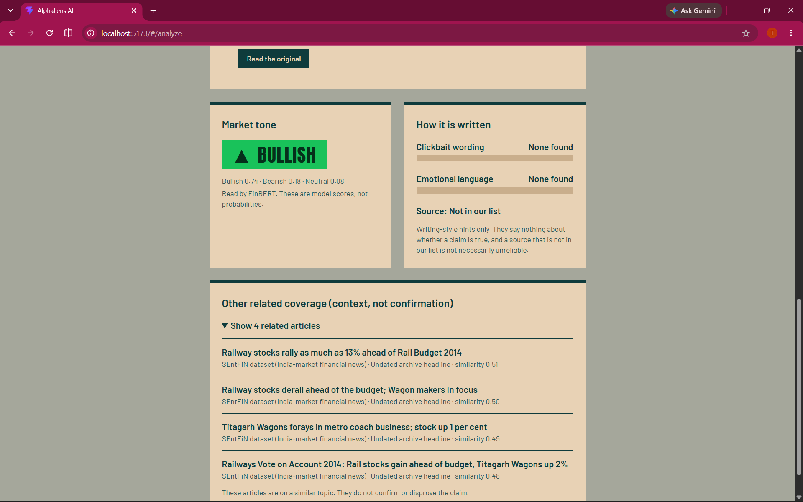
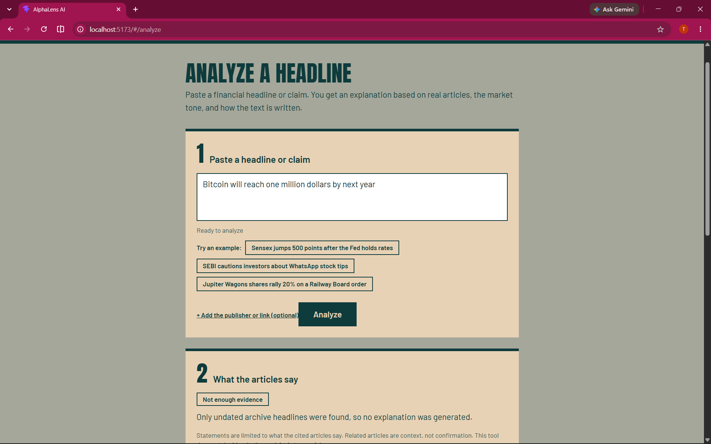

# AlphaLens AI

A portfolio project built while preparing for AI engineering placements. You paste a financial headline or claim, and AlphaLens explains it **using only articles it actually retrieved**, with the publisher, date and link for each one. It also shows the market tone and how the text is written.

> **Version note.** This README describes **V2**, which is merged into `main`. The older V1 design combined a fake-news classifier and a composite credibility score. V2 removes both. V1 is preserved as the git tag `v1-final`, and its demo site has been taken offline. See [What changed from V1](#what-changed-from-v1-and-why).

**What it is not:** a fact-checker, trading advice, or an alert service. It never says a claim is true or false. Related articles are context, not confirmation.

## Screenshots

| Landing | A claim that differs from the article (1) |
|---|---|
|  |  |

| A claim that differs from the article (2) | Refuses when evidence is missing |
|---|---|
|  |  |

## What it does

For each headline or claim you submit:

1. **Explanation.** 1 to 3 short statements, each citing the articles it came from. A "cited article" is a retrieved item (its headline and short snippet, not the full text) that a statement relies on. If nothing relevant is found, it says so instead of guessing. Differences between your claim and the cited text (numbers, rise/fall) are listed separately, found by code.
2. **Evidence.** The cited articles, with publisher, date, link and a similarity score. Items with no date are tagged as undated archive headlines.
3. **Market tone.** FinBERT label (Bullish, Bearish, Neutral) with model scores. These are softmax scores, not calibrated probabilities.
4. **Writing signals.** Clickbait wording and emotional language, each with the phrases that triggered it, plus a limited source-context note (known outlet or not in our list). A source that is not in our list is not treated as unreliable.
5. **Other related coverage.** Collapsed, labeled as context.

The web app has four pages: Landing, Analyze, Evaluation, and How it works.

## Who it is for

Aimed at a retail investor or finance student who sees a headline (for example on WhatsApp) and wants context: what indexed articles say, with publisher, date and link, plus the market tone and writing style. It is a working demonstration of an evidence-grounded pipeline, not a news service: the recent-article index is small, so many real headlines will return "not enough evidence".

## Where the evidence comes from

All sources live in one local index and are searched together by similarity of meaning, with no source searched first. Nothing is fetched when you submit a headline. Articles are added ahead of time by running the ingestion scripts, the usual pattern for retrieval systems. Searching a news API at query time was left out on purpose: the free plan delays articles by 24 hours and allows about 100 requests a day, and turning a claim into a good search query is unreliable.

- **NewsAPI**: recent articles with publisher, date and link.
- **SEBI feed**: the regulator's own press releases and circulars, a primary source for claims about SEBI.
- **SEntFiN**: older undated headlines, used only as context.

The LLM does not search or fetch. It only reads the retrieved articles and writes the cited statements, which code then validates.

## How it works

```
SEntFiN headlines + SEBI RSS feed + NewsAPI
        -> SQLite article store (provenance, de-duplication)
        -> ChromaDB vector index (sentence-transformers all-MiniLM-L6-v2)

claim -> retrieve similar articles
      -> show identical headlines once (the claim's own match is kept: it is the best evidence)
      -> refuse if nothing is similar enough, or only undated items exist
      -> LLM writes statements that must cite evidence ids
      -> code drops any statement that cites an id it was not given,
         or contains a number found in neither the claim nor the cited text
      -> code lists differences between the claim and the cited text (numbers, rise/fall)
      -> FastAPI response -> React cards
```

Key design points:

- **Citations are validated in code.** A statement that cites an unknown article is dropped. A valid citation only proves the model pointed at a real article, not that the article supports the statement, so support is measured by hand (see Evaluation).
- **Differences are found by code, not by the LLM.** Numbers in the claim that the cited headline or snippet does not contain, and opposite words (rise/fall, likely/unlikely, hike/cut), are listed. This only looks at the headline and short snippet we hold.
- **Provenance is never invented.** If a publisher, date or URL is missing, the field stays empty.
- **Rules that must always hold live in code, not in the prompt.** Example: refusing when only undated archive headlines exist.
- **The LLM is provider-agnostic.** It uses the OpenAI SDK against any OpenAI-compatible endpoint. Development used Groq.

## What changed from V1 and why

| V1 feature | V2 | Reason |
|---|---|---|
| DistilBERT real/fake classifier | Removed | Trained on general and political news, not validated for financial news. A simple TF-IDF model scored almost as well, which points to publisher-style leakage. A high score on the wrong task is not evidence for the real task |
| Composite credibility score with Reliable / Needs Verification / High Risk | Removed | Hand-set weights, and the labels implied a level of verification the system does not have |
| Sentiment-agreement "consensus" | Removed | Several outlets can repeat the same unsupported claim, and agreement in tone is not corroboration |
| Retrieval with no ids, URLs or dates | Fixed | Evidence needs a stable id and honest provenance |
| Retrieval evaluated on queries taken from the index | Replaced | A query could retrieve itself at similarity 1.0, inflating the metric. Benchmarks now exclude self-matches (`exclude_self`). The product keeps an exact match, because it is the best evidence |
| Wildcard CORS, liveness-only health check | Fixed | CORS is limited to configured origins, and `/ready` reports readiness |

## Data sources

| Source | What it gives | Notes |
|---|---|---|
| SEntFiN dataset (Kaggle) | 10,686 India-market headlines | No dates or links, so these are treated as undated archive context. Download it yourself, it is not in the repo |
| SEBI RSS feed | Press releases and circulars | Items are filtered to press releases and circulars only, to avoid enforcement notices that name private individuals. SEBI's website policy asks for permission to reproduce content, so the stored items are not redistributed |
| NewsAPI | Recent articles with publisher, date and link | Free developer plan, intended for development use. Only titles, short descriptions, links and dates are stored |

Publisher RSS terms were read before choosing feeds. One major publisher's feed allows personal, non-commercial use only, so it is not used. Because the sources are licensed for development and personal use, **this project is not deployed**. The ingested data stays local and is not committed.

## Evaluation

A development check on **20 hand-written claims**: 9 covered by indexed articles, 5 off-topic, and 6 adversarial (wrong number, wrong direction, unsupported event).

| Result | Count |
|---|---|
| Covered claims answered with a cited article | 9 / 9 |
| Off-topic claims refused | 5 / 5 |
| Adversarial claims | 2 answered by stating the mismatch, 4 refused |
| Statements judged supported by their cited article (hand-labeled) | 13 / 13 |
| Answers that presented a mismatched claim as confirmed | 0 / 11 |

**Read these numbers carefully:**

- This is **not a benchmark**. The prompt and code were tuned on these same 20 claims after reading the outputs, so the results are optimistic.
- One person wrote and labeled the claims, with AI-assisted guidance during labeling.
- Most items are headline-length, so many statements restate the headline. The value here is traceability and mismatch flagging, not deeper analysis.
- The first version of the check looked perfect on counts (9/9, 5/5) while reading the outputs showed padding from old headlines and wrongly attributed sources. That led to statement-level labeling and the fixes listed on the Evaluation page.
- Held-out results are in the next section.

### Held-out evaluation

To get numbers that were not tuned on, claims were generated from recent indexed articles: a paraphrase of each headline (the source article is the known right answer), a version with one fact changed, and 20 fixed off-topic claims. Each claim file was reviewed once, then frozen (its hash is stored with the results) and run once. Known-item retrieval, off-topic refusal and citation validity are scored automatically. Whether statements are supported was hand-labeled on a random sample of 30 answers.

| | v1 (before the fix) | v2 (after the fix) |
|---|---|---|
| Claims (paraphrased / altered / off-topic) | 26 / 26 / 20 | 28 / 28 / 20 |
| Known-item Recall@5, paraphrased claims | 92% (MRR 0.90) | 100% (MRR 0.97) |
| Known-item Recall@5, altered claims | 23% (MRR 0.23) | 100% (MRR 0.98) |
| Off-topic claims refused | 20 / 20 | 20 / 20 |
| Altered claims answered | 9 / 26 | 27 / 28 |
| Hand-labeled statements: supported / partly / not supported | 35 / 7 / 0 of 42 \* | 46 / 2 / 0 of 48 † |
| Answers that presented a mismatched claim as confirmed (sample of 30) | 4 / 30 \* | 0 / 30 |
| Explanation latency, median / 95th percentile | 1.5 s / 13.5 s \*\* | 1.6 s / 3.6 s |

\* After correcting 2 labels that broke the labeling rule ("does the cited text say this?"). As first labeled, v1 was 32 / 7 / 3 and 6 / 30.

† After correcting 1 label (claim 10, statement 1) for the same reason: the cited text and publisher did say what the statement said. As first labeled, v2 was 45 / 2 / 1.

\*\* The v1 tail includes waits caused by provider rate limits.

All corrections are reported on purpose, and no other label was changed.

**What the first run found.** Altered claims (one fact changed) rarely retrieved their source article. A diagnostic showed the source article was the top raw match for 25 of 26 altered claims, but a near-duplicate filter, written to keep benchmark queries from retrieving themselves, removed it in 20 of them. In the product this meant that pasting a headline that was already indexed discarded that exact article. The filter now applies only to benchmarks. Three code-level checks were added: statements containing a number found in neither the claim nor the cited text are dropped, differences between the claim and the cited headline or snippet (numbers, rise/fall, likely/unlikely, hike/cut) are listed by code, and two prompt rules were tightened.

**What the second run showed.** On a fresh claim set (new articles, financial headlines only, none used in v1), the code listed a difference for 13 of 27 answered altered claims and for 0 of 27 faithful paraphrases. Where an altered number could be checked, the answer mentioned the real number in 9 of 9 cases.

**Limits of these numbers:**

- Claims were written by an LLM of the same family as the explainer, and paraphrases of an indexed headline are easier than real user claims. "Recall@5" here means known-item search, not general retrieval quality.
- The hand-labeled sample is 30 answers (48 statements), labeled by one person who also built the system. With 0 of 30 overclaims, the true rate could still be around 10%.
- v2 is not a controlled comparison with v1: different articles, a financial-only filter and a different seed. The code and prompt were changed between runs because of v1 failures, but the v2 claims were not looked at before the run.
- One claim in each run failed with an LLM error and counts as a failure.
- The code checks do not catch wording-only changes such as "similar" vs "different" or "Shares" vs "Receipts".
- Claim files and results contain licensed headline text, so they are not committed.

### Reproduce the evaluations

Run from `backend/`. Claim files and results are gitignored.

```
# Development check (20 hand-written claims; the labeling step is interactive)
python evaluation/explain_eval.py run
python evaluation/explain_eval.py label

# Held-out set (PowerShell shown; HELDOUT_TAG selects a separate claim set)
$env:HELDOUT_TAG = "_v2"; $env:HELDOUT_SEED = "11"
python evaluation/build_heldout.py 30      # generate claims from recent articles
python evaluation/drop_claims.py list      # review, remove non-financial items, then freeze
python evaluation/run_heldout.py           # run once; resumable after a rate limit
$env:EXPLAIN_RESULTS = "evaluation/explain_results_heldout_v2.json"
python evaluation/explain_eval.py label    # hand-label a sample
python evaluation/heldout_report.py        # breakdown by claim type, and the failures
python evaluation/latency.py               # per-stage timing
```

## Tests and CI

106 tests (103 run by default) cover the explanation service (invalid citations, bad JSON, LLM failure, refusals), retrieval filtering, the sentiment service and API, source signals, CORS and health endpoints, and the removal of the old features. The LLM and retrieval are faked, so tests need no API key or model download. Three extra tests that load the real FinBERT model are skipped unless you opt in.

```
cd backend
python -m pytest -q
RUN_MODEL_TESTS=1 python -m pytest tests/test_sentiment_service.py -q   # PowerShell: $env:RUN_MODEL_TESTS="1"
```

GitHub Actions runs the default suite on every push.

## Running it locally

**Backend**

```
python -m venv .venv
.venv\Scripts\activate          # macOS/Linux: source .venv/bin/activate
pip install -r requirements.txt
cd backend
uvicorn app.main:app --reload --port 8000
```

Create `backend/.env` (never commit it):

```
OPENAI_API_KEY=your_key         # any OpenAI-compatible provider works, names stay OPENAI_*
OPENAI_BASE_URL=https://api.groq.com/openai/v1
OPENAI_MODEL_NAME=openai/gpt-oss-20b
NEWSAPI_KEY=your_key            # only for training/fetch_newsapi.py
CORS_ORIGINS=http://localhost:5173,http://127.0.0.1:5173
```

Check `http://localhost:8000/docs` for the API and `http://localhost:8000/ready` for readiness.

**Frontend** (second terminal)

```
cd frontend
npm install
npm run dev
```

**Building the article store** (from `backend/`)

```
python training/migrate_sentfin.py   # SEntFiN CSV -> SQLite (safe to repeat)
python training/fetch_rss.py         # SEBI feed -> SQLite + vector index
python training/fetch_newsapi.py     # NewsAPI -> SQLite + vector index
python training/purge_origin.py newsapi   # remove one origin's rows (never sentfin)
```

Place the SEntFiN CSV at `backend/training/data/SEntFiN-v1.1.csv` first. The vector store and `articles.db` are local and gitignored. `training/ingest_corpus.py` is the original one-time index builder and **deletes the collection when it runs**, so never run it after adding live articles.

## Limitations

- Retrieval is a small sentence-embedding model over short headlines. It can rank by shared wording instead of meaning, and it was only tested as known-item search (paraphrases and edits of indexed headlines), not on independent real-world queries.
- The corpus skews toward Indian markets, and SEntFiN items carry no dates, so they are never used on their own to explain a current claim. As a result, a claim about an old event is refused if only old headlines exist.
- The code checks catch changed numbers and opposite words, not subtle wording changes such as "Shares" vs "Receipts".
- The explainer sometimes restates a headline. It cannot check facts beyond what the retrieved articles say, and with one source it reports that one source.
- The evaluations are small and author-labeled, and the development check was tuned on, as described above.
- There is no way yet to rebuild the vector index from SQLite in one command, which is planned.
- No authentication, accounts or multi-user support, by design.

## Project layout

```
backend/app/        FastAPI app: api/, schemas/, services/ (sentiment, retrieval, explanation, signals)
backend/training/   article store and ingestion scripts (SQLite, RSS, NewsAPI)
backend/evaluation/ evaluation, review and latency scripts
backend/tests/      pytest suite
frontend/src/       React + Vite + Tailwind: pages/, components/
docs/screenshots/   README images
.github/workflows/  CI
```

## Stack

Python, FastAPI, Pydantic, Transformers (FinBERT), Sentence Transformers, ChromaDB, SQLite, OpenAI SDK (Groq in development), React, Vite, Tailwind, pytest, GitHub Actions.